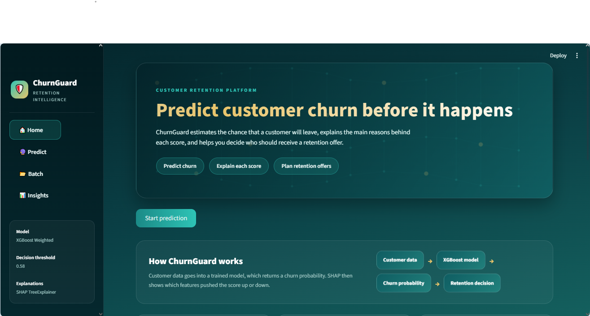
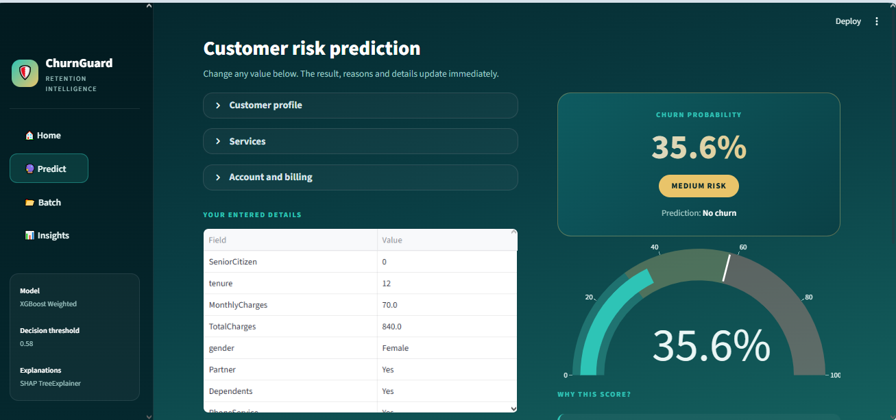
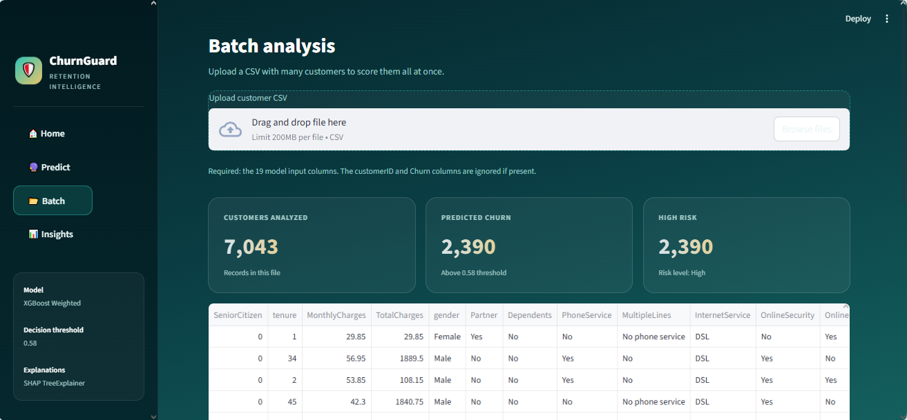
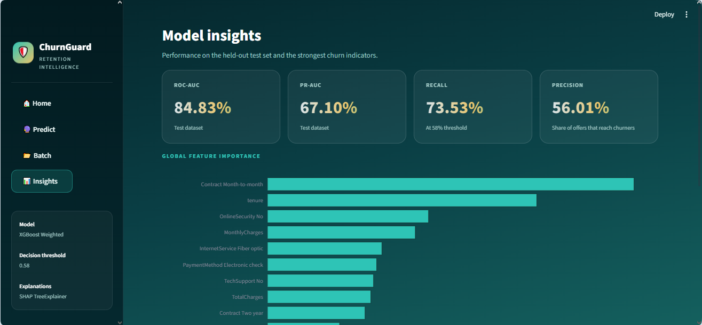

# ChurnGuard: Customer Churn Prediction

ChurnGuard predicts which telecom customers are likely to leave, explains the main reasons behind each prediction, and helps the team decide who should get a retention offer.

## Table of Contents

1. [Problem](#1-problem)
2. [Dataset](#2-dataset)
3. [Approach](#3-approach)
4. [Final Results](#4-final-results)
5. [Screenshots](#5-screenshots)
6. [Project Structure](#6-project-structure)
7. [How to Run](#7-how-to-run)
8. [App Pages](#8-app-pages)
9. [Limitations](#9-limitations)
10. [Tech Stack](#10-tech-stack)

---

## 1. Problem

Keeping an existing customer is usually cheaper than finding a new one. But a company cannot send a retention offer to everyone, because offers cost money.

I wanted to answer one question: **which customers are most likely to churn in the near future?** With that answer, the team can focus offers on the right customers instead of guessing.

## 2. Dataset

I used the **Telco Customer Churn** dataset.

- **Rows:** 7,043 customers
- **Columns:** 21 (19 input features, 1 ID column, 1 target column)
- **Target:** `Churn` (Yes or No)
- **Churn rate:** about 26.5%, so the data is imbalanced

Main feature groups:

- **Customer info:** gender, senior citizen, partner, dependents
- **Services:** phone, internet, online security, tech support, streaming
- **Account:** contract type, paperless billing, payment method
- **Numbers:** tenure, monthly charges, total charges

### Data cleaning

- `TotalCharges` had 11 blank values. These were customers with a tenure of 0, so I filled them with 0.
- I checked for duplicate customer IDs, negative values, and tenure above 72 months. I found none.
- `customerID` is kept only for reference and is not used by the model.

## 3. Approach

1. **Audit:** checked the raw data and saved a dataset audit report.
2. **Cleaning:** fixed the `TotalCharges` column and saved a cleaning report.
3. **EDA:** looked at churn rates by contract, internet service, payment method, tenure and charges.
4. **Split:** split the data into 80% train and 20% test, using stratified sampling.
5. **Imbalance handling:** compared two methods, class weights and SMOTENC.
6. **Model comparison:** trained Logistic Regression, Random Forest and XGBoost with both methods, using 5-fold stratified cross-validation.
7. **Threshold:** chose the decision threshold (0.58) using estimated business costs, not the default 0.50.
8. **Final test:** trained the chosen model on the full training set and evaluated it once on the test set.
9. **Explainability:** used SHAP to show which features matter most, both overall and for each customer.
10. **App:** built a Streamlit app for single predictions, batch scoring, and model insights.

### Cross-validation results

I used PR-AUC as the main comparison metric.

| Model | PR-AUC (mean) | Std |
|---|---|---|
| XGBoost (class weights) | 0.669 | 0.023 |
| Logistic Regression (class weights) | 0.660 | 0.022 |
| XGBoost (SMOTENC) | 0.660 | 0.020 |
| Logistic Regression (SMOTENC) | 0.650 | 0.028 |
| Random Forest (class weights) | 0.610 | 0.034 |
| Random Forest (SMOTENC) | 0.590 | 0.036 |
| Dummy baseline | 0.265 | 0.000 |

The top three models are close to each other. The standard deviations overlap, so I did not treat XGBoost as a clear winner. I chose it because it had the highest mean PR-AUC, and it works well with the class-weight approach.

## 4. Final Results

These results come from the held-out test set, which the model did not see during training or model selection.

| Metric | Score | What it means |
|---|---|---|
| Accuracy | 77.64% | Share of all predictions that were correct |
| Precision | 56.01% | Of customers flagged as churners, how many really churned |
| Recall | 73.53% | Of all real churners, how many the model found |
| F1-score | 0.636 | Balance between precision and recall |
| ROC-AUC | 0.848 | How well the model ranks churners above non-churners |
| PR-AUC | 0.671 | Main metric for imbalanced data |

Accuracy is shown here for completeness, but it is not the metric I use to judge the model. A model that always predicts "No churn" would get about 73.5% accuracy on this data, and it would find no churners at all.

### Decision threshold

The default threshold of 0.50 treats a missed churner and a wasted offer as equally costly. They are not equal, so I set the threshold to 0.58 based on these assumptions:

- Retention offer cost: $20 per customer
- Value of a lost customer: $200
- Chance that an offer saves the customer: 30%

These numbers are my assumptions for this project, not real company data. Change them in the code if your business numbers are different.

## 5. Screenshots

> Add screenshots to the `plots/screenshots/` folder with these file names, then they will show here automatically.

| Page | Preview |
|---|---|
| Home |  |
| Single prediction |  |
| Batch analysis |  |
| Model insights |  |

## 6. Project Structure

```
ChurnGuard/
├── app.py                  # Streamlit app
├── check_model.py          # Quick check that the model loads
├── requirements.txt        # Python packages
├── data/                   # Raw and cleaned CSV files
├── models/                 # Saved preprocessor, classifier and final model
├── results/                # Metrics, SHAP values, threshold and CV results
├── plots/                  # Charts from the notebook
├── checkpoints/            # Train/test split and CV checkpoints
└── docs/screenshots/       # Screenshots for this README
```

## 7. How to Run

### Requirements

- Python 3.12 or 3.13
- The packages in `requirements.txt`

### Steps

1. Clone or download the project and open the folder.

2. Create and activate a virtual environment:

   ```bash
   python -m venv venv
   venv\Scripts\activate        # Windows
   source venv/bin/activate     # Mac/Linux
   ```

3. Install the packages:

   ```bash
   pip install -r requirements.txt
   ```

4. Start the app:

   ```bash
   streamlit run app.py
   ```

5. Open the link shown in the terminal, usually `http://localhost:8501`.

### If the project is in a different folder

The app looks for the `models` and `results` folders next to `app.py`. If your project is somewhere else, set this variable before running:

```bash
set CHURNGUARD_DIR=path\to\ChurnGuard       # Windows
export CHURNGUARD_DIR=/path/to/ChurnGuard   # Mac/Linux
```

### Check the model

To confirm the saved model loads and gives the expected results:

```bash
python check_model.py
```

## 8. App Pages

- **Home:** project overview, key numbers, and a button to start a prediction.
- **Predict:** enter one customer's details and see the churn probability, risk level, the main reasons, and a PDF report.
- **Batch:** upload a CSV with the 19 input columns and download the results as CSV or a PDF summary.
- **Insights:** model performance, configuration, and the top features by SHAP importance.

### Batch CSV format

The CSV must include these columns:

`gender, SeniorCitizen, Partner, Dependents, tenure, PhoneService, MultipleLines, InternetService, OnlineSecurity, OnlineBackup, DeviceProtection, TechSupport, StreamingTV, StreamingMovies, Contract, PaperlessBilling, PaymentMethod, MonthlyCharges, TotalCharges`

`customerID` and `Churn` are ignored if they are present.

## 9. Limitations

- **Sample data:** the Telco dataset is a well-known sample, not data from a real company. Results may not match a real customer base.
- **No time information:** each customer is a single snapshot. The model does not see how usage or spending changed over time, which may be important for predicting churn.
- **Cost assumptions:** the threshold depends on the $20, $200 and 30% numbers. If these are wrong, the best threshold will be wrong too.
- **No calibration:** the probabilities are not calibrated. The Brier score is 0.161, so a score of 60% does not reliably mean a 60% chance of churn.
- **Single test split:** the final result comes from one 80/20 split. Other splits may give slightly different numbers.
- **Close model results:** the top three models are within each other's standard deviation, so the choice of XGBoost is not strongly proven.
- **SHAP shows patterns, not causes:** a feature with a high SHAP value is related to the prediction. It does not prove that changing that feature will stop a customer from leaving.
- **Fairness not checked:** I did not test whether the model treats groups such as senior citizens or different genders differently.
- **Version sensitivity:** the saved XGBoost and scikit-learn files work best with the versions in `requirements.txt`. Other versions may give errors or slightly different results.
- **Local app only:** the app reads files from the local folder. It is not deployed or secured for public use.

## 10. Tech Stack

- **Data and modelling:** Python, pandas, NumPy, scikit-learn, XGBoost, imbalanced-learn
- **Explainability:** SHAP
- **App and charts:** Streamlit, Plotly
- **Reports:** ReportLab (PDF)
- **Development:** Google Colab for the notebook, VS Code for the app